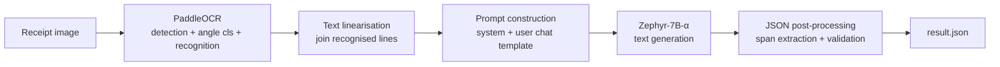

# ReceiptLens

**Zero-shot structured information extraction from receipts and invoices using a two-stage OCR → LLM pipeline.**


---

## Table of Contents

1. [Abstract](#abstract)
2. [Motivation](#motivation)
3. [Method](#method)
4. [Repository Structure](#repository-structure)
5. [Getting Started](#getting-started)
6. [Usage](#usage)
7. [Design Decisions](#design-decisions)
8. [Limitations](#limitations)
9. [Evaluation Plan](#evaluation-plan)
10. [Future Work](#future-work)
11. [References](#references)
12. [License](#license)

---

## Abstract

Pulling key fields such as vendor, date, line items and totals out of scanned receipts is a long-standing problem in document understanding. Classical solutions rely on template rules or on layout-aware models trained on labelled datasets such as SROIE and CORD, so they do not transfer well to unseen document formats. **ReceiptLens** tests a lighter alternative that needs no training. It decouples *perception* from *understanding*:

1. **PaddleOCR** (PP-OCR) detects and recognises the text in the image.
2. An instruction-tuned LLM, **Zephyr-7B-α**, reads the flattened OCR text and converts it to **structured JSON** from a natural-language instruction. No fine-tuning is involved.

The result is a modular pipeline in which either stage can be swapped out independently, and where adding a new document type only means writing a new prompt.

## Motivation

- **Annotation cost.** Layout-aware extractors such as LayoutLM and Donut need labelled training data for every new document schema.
- **Format diversity.** Receipts vary widely in layout, font, language and print quality, which makes rule-based parsers brittle.
- **The generalisation of LLMs.** Instruction-tuned LLMs can follow schema descriptions zero-shot and tolerate noisy, unordered input text.

ReceiptLens explores how far a fully off-the-shelf, open-weight stack can go on this task.

## Method



### Stage 1: Optical Character Recognition

PaddleOCR is configured with the angle classifier enabled (`use_angle_cls=True`), so rotated text lines are handled, and with `use_space_char=True`, so word boundaries are kept. The recognised lines are concatenated in reading order into one string, `raw_text`.

### Stage 2: LLM-based Structuring

The OCR text is wrapped in a chat-formatted prompt, using the model's own chat template through `tokenizer.apply_chat_template`:

| Role | Content |
|---|---|
| `system` | Defines the model as a JSON converter for raw OCR text |
| `user` | Lists the target fields and includes the OCR text |

Generation settings: `max_new_tokens=1000`, `temperature=0.7`, `top_k=50`, `top_p=0.95`, loaded in `bfloat16` with `device_map="auto"`.

### Stage 3: Post-processing

LLMs often wrap JSON in prose or code fences. The pipeline takes the span between the first `{` and the last `}`, validates it with `json.loads`, and writes the parsed object to `result.json`. If the output is malformed, it reports the error instead of failing silently.

## Repository Structure

```
.
├── receiptlens.ipynb   # End-to-end pipeline (OCR → LLM → JSON)
├── data/               # Sample receipt / invoice images
│   ├── bill_1.jpg … bill_5.jpg
│   └── test_1.jpg, test_2.jpg
└── README.md
```

## Getting Started

### Requirements

- Python 3.10+
- A CUDA GPU with about 16 GB of VRAM for Zephyr-7B in `bfloat16`. The free Colab T4 tier is enough with `device_map="auto"` offloading.

### Installation

```bash
git clone https://github.com/MuhammadRehanRasool/ReceiptLens.git
cd ReceiptLens

pip install git+https://github.com/huggingface/transformers.git
pip install accelerate
pip install paddlepaddle-gpu
pip install "paddleocr>=2.0.1"
```

Google Colab is the recommended runtime: upload `receiptlens.ipynb` and the images from `data/`.

## Usage

```python
import torch
from paddleocr import PaddleOCR
from transformers import pipeline

reader = PaddleOCR(use_angle_cls=True, lang='en', use_space_char=True)
llm = pipeline("text-generation", model="HuggingFaceH4/zephyr-7b-alpha",
               torch_dtype=torch.bfloat16, device_map="auto")

# Stage 1: OCR
ocr_result = reader.ocr('data/bill_1.jpg', cls=True)
raw_text = " ".join(line[1][0] for line in ocr_result[0])

# Stages 2 + 3: LLM structuring and JSON export (defined in the notebook)
data = extract_bill('data/bill_1.jpg')   # also writes result.json
```

## Design Decisions

| Decision | Rationale |
|---|---|
| **Two-stage pipeline** instead of an end-to-end OCR-free model | Each stage can be inspected and upgraded on its own, and OCR errors can be told apart from reasoning errors |
| **PaddleOCR** | Light, accurate, supports multiple languages (`en`, `ch`, `fr`, `german`, `korean`, `japan`), and runs on a GPU |
| **Zephyr-7B-α** | Open weights, strong instruction following for its size (a Mistral-7B base aligned with distilled DPO), and fits on a single consumer or Colab GPU |
| **Zero-shot prompting** | Needs no labelled data, and adapting to a new schema is a prompt edit |
| **Chat template through the tokenizer** | Makes sure the prompt matches the format the model was aligned on |

## Limitations

- **Loss of layout.** Flattening OCR output into one string discards 2-D spatial information, so table structure and key–value alignment must be inferred by the LLM.
- **Errors carry over.** OCR mistakes, such as misread digits in prices, pass straight into the LLM stage.
- **Hallucination.** The LLM may invent or "correct" values that are not in the source text.
- **Output is not deterministic.** Sampling (`temperature=0.7`) can produce different outputs for the same input.
- **Demo prompt.** The current prompt in the notebook targets boarding-pass fields as a proof of concept. A receipt-specific schema (vendor, date, items, totals) is the next step.
- **Not yet benchmarked.** No quantitative evaluation has been carried out so far (see below).

## Evaluation Plan

The proposed protocol for a quantitative assessment:

- **Datasets.** SROIE (ICDAR 2019) for key-field extraction (company, date, address, total), and CORD for line-item parsing.
- **Metrics.** Field-level precision, recall and F1 with exact match; normalised edit distance for partial matches; and the rate of valid JSON.
- **Ablations.** OCR engine (PaddleOCR vs. Tesseract), LLM size and family, greedy vs. sampled decoding, zero-shot vs. few-shot prompts, and plain vs. layout-aware linearisation, for example adding bounding-box coordinates.

## Future Work

- [ ] Receipt and invoice schema with JSON-schema–constrained decoding
- [ ] Few-shot prompting with in-context examples
- [ ] Linearisation that keeps the layout (coordinates, line grouping)
- [ ] Batch processing and PDF input
- [ ] Quantitative benchmark on SROIE and CORD
- [ ] Comparison with OCR-free baselines (Donut) and newer open LLMs
- [ ] REST API or Gradio demo

## References

1. Du, Y. et al. *PP-OCR: A Practical Ultra Lightweight OCR System.* arXiv:2009.09941, 2020.
2. Tunstall, L. et al. *Zephyr: Direct Distillation of LM Alignment.* arXiv:2310.16944, 2023.
3. Jiang, A. Q. et al. *Mistral 7B.* arXiv:2310.06825, 2023.
4. Rafailov, R. et al. *Direct Preference Optimization: Your Language Model is Secretly a Reward Model.* NeurIPS, 2023.
5. Xu, Y. et al. *LayoutLM: Pre-training of Text and Layout for Document Image Understanding.* KDD, 2020.
6. Kim, G. et al. *OCR-free Document Understanding Transformer (Donut).* ECCV, 2022.
7. Huang, Z. et al. *ICDAR 2019 Competition on Scanned Receipt OCR and Information Extraction (SROIE).* ICDAR, 2019.
8. Park, S. et al. *CORD: A Consolidated Receipt Dataset for Post-OCR Parsing.* NeurIPS Workshop on Document Intelligence, 2019.

## License

Released under the [MIT License](LICENSE).
